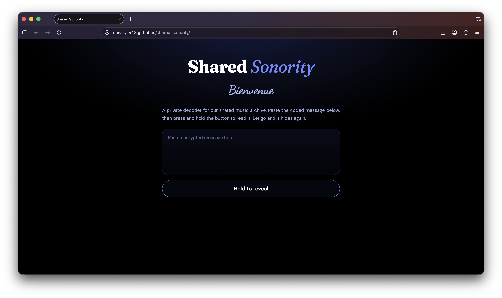

# Shared Sonority

*Two minds, divergent tastes on shared sonority. ∞*

A small private decoder for a shared music archive. Paste an encrypted message, press and hold the button, and the message is revealed. Let go and it disappears again.

**Live site:** https://canary-543.github.io/shared-sonority/



## How to use

1. Paste the encrypted message into the text box.
2. Press and hold the **Hold to reveal** button. A blue fill slides across the button.
3. When the fill reaches the end, the decoded message replaces the text in the box.
4. Release the button and the encrypted message comes back straight away.

If you let go before the fill reaches the end, nothing is revealed. If the box is empty or the message isn't valid, the page shows an error while you hold the button.

## How it works

Messages are compressed with DEFLATE and then packed into CJK Unicode characters, which carry more data per character than letters or digits. That keeps a long message short enough to paste or share easily.

Decoding happens entirely in your browser. Nothing you paste is sent to a server.

### Creating a message

Use this Python script to turn English text into an encrypted message the page can read:

```python
import zlib

BASE, N = 0x4E00, 0x9FFF - 0x4E00 + 1  # 20992 symbols

def encode(text):
    c = zlib.compressobj(9, zlib.DEFLATED, -15)
    z = c.compress(text.encode()) + c.flush()
    n = int.from_bytes(b"\x01" + z, "big")
    out = []
    while n:
        n, r = divmod(n, N)
        out.append(chr(BASE + r))
    return "".join(reversed(out))

print(encode("Your message here"))
```

## Features

- Press-and-hold reveal with an eased slide animation
- Greeting that cycles through "Welcome" in different languages with a 3D cube transition
- Custom dark text box with a tulip blue and black theme
- Works on desktop and mobile, with touch and keyboard support (hold Space or Enter)

## Built with

- Plain HTML, CSS and JavaScript in a single `index.html` file
- [pako](https://github.com/nodeca/pako) 2.1.0 (loaded from cdnjs) for decompression
- Google Fonts: Fraunces, DM Sans and Dancing Script

## Run it locally

No build step is needed. Download `index.html` and open it in a browser. An internet connection is needed for the fonts and the decompression library.

## Hosting

The site is published with GitHub Pages from the `main` branch, root folder.
